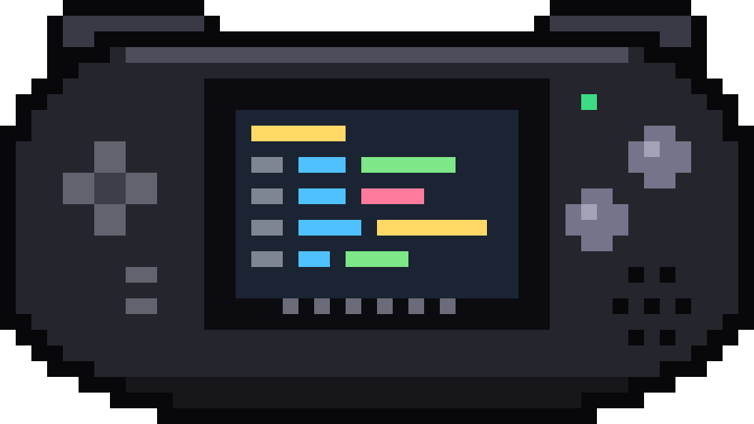
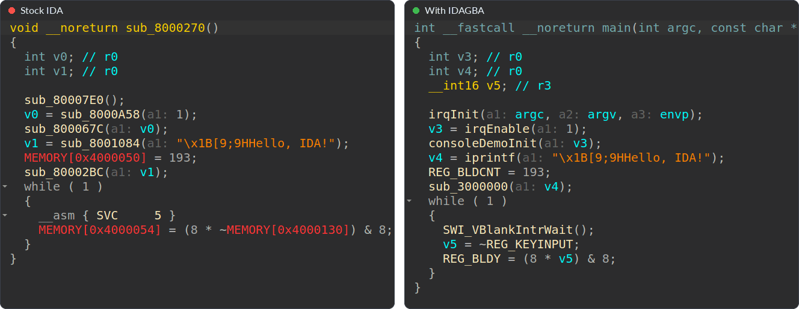
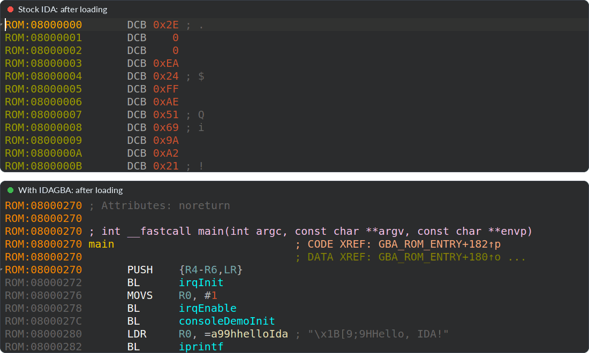
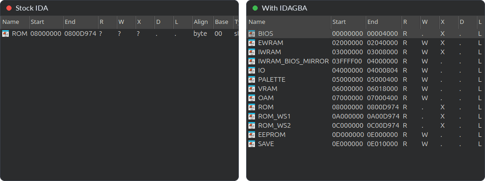
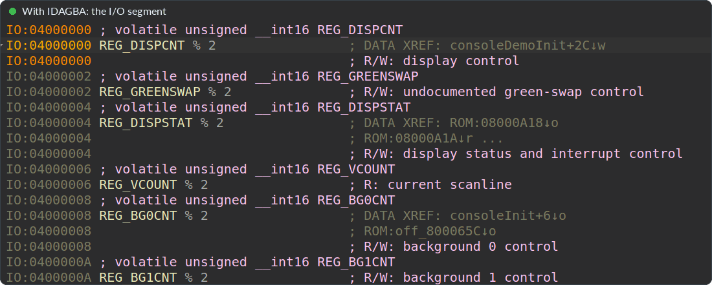
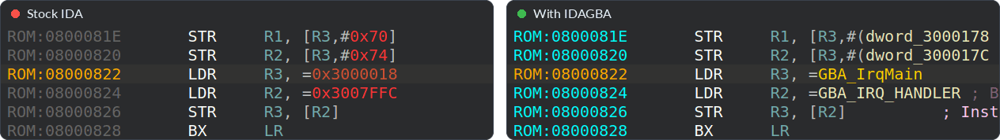
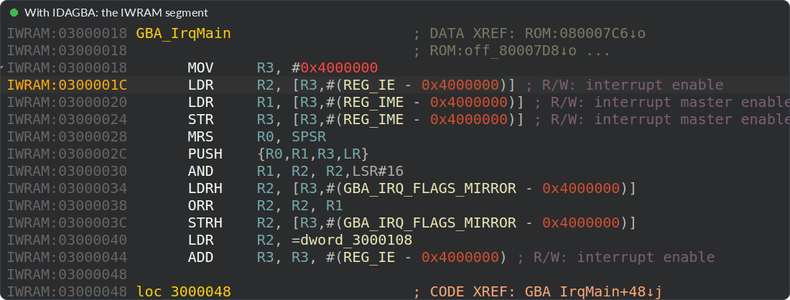
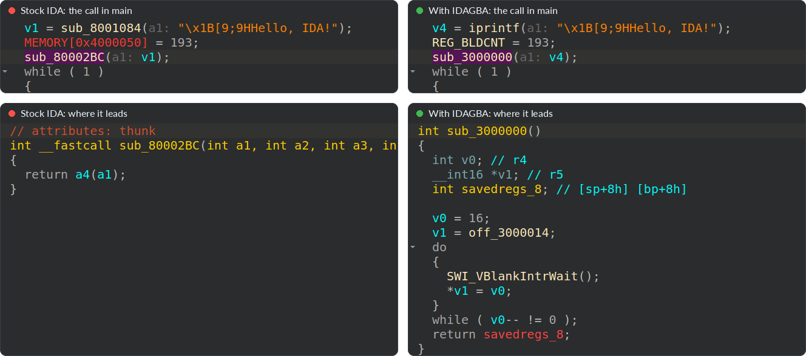
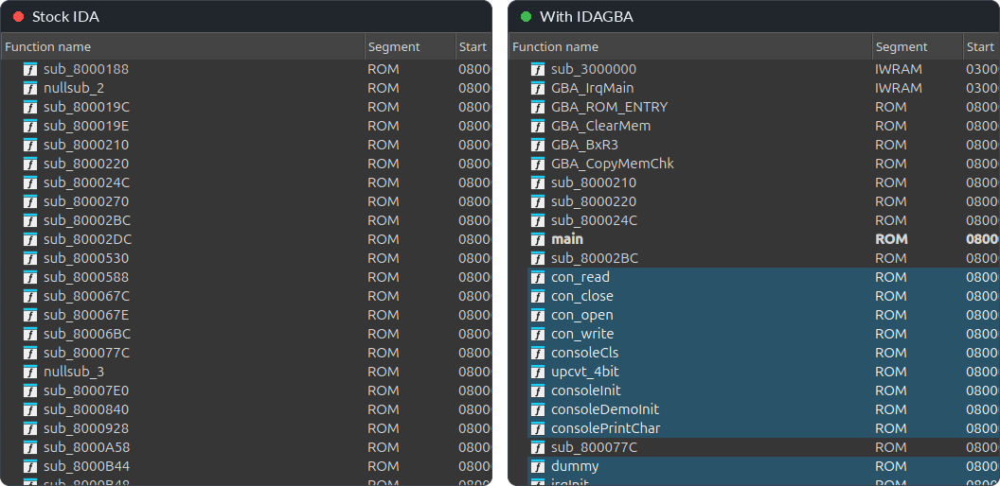
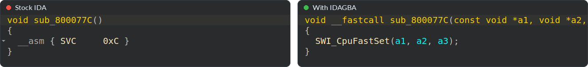

<div align="center">



# IDAGBA

**A loader and plugin for Game Boy Advance (GBA) ROMs in IDA Pro**

[](https://hex-rays.com/ida-pro) [](https://www.python.org/) [](LICENSE)

</div>


## Overview

IDAGBA is a loader and decompiler plugin for Game Boy Advance ROMs that fills this in when you load a file:

- The console's memory map
- A name for every I/O register
- The startup code, followed all the way to `main`
- The RAM contents that the startup code copies out of the ROM
- Library functions, recognized by signature
- BIOS calls, shown as ordinary function calls
- Calls through stubs, shown as calls to the function they reach

## A quick before and after



**Left**: IDA alone, with the ROM loaded as a raw ARM binary at `0x08000000` and the entry point marked as code by hand.

**Right**: the same file opened with IDAGBA and no manual work to find main.

<details>
<summary>The program in the screenshots</summary>

```c
// Built with devkitARM r68 and libgba, from devkitPro's `template` example.
#include <gba.h>
#include <stdio.h>

// Runs from IWRAM so it gets copied to there at startup
IWRAM_CODE __attribute__((noinline)) void fade_in(void) {
	for (int level = 16; level >= 0; level--) {
		VBlankIntrWait();
		REG_BLDY = level;
	}
}

int main(void) {
	irqInit();
	irqEnable(IRQ_VBLANK);

	consoleDemoInit();
	iprintf("\x1b[9;9HHello, IDA!");

	REG_BLDCNT = 0x00C1;
	fade_in();
	while (1) {
		VBlankIntrWait();
		REG_BLDY = (REG_KEYINPUT & KEY_A) ? 0 : 8;
	}
}
```

</details>

## What it does

### Finds `main`

IDAGBA is able to recognize devkitARM's startup code, name its parts, and then jump to the real `main` automatically.



### Builds the memory map

Stock IDA doesn't know anything about the address space, so IDAGBA recreates the whole thing from scratch.



### Labels the I/O registers

There are 99 I/O registers. IDAGBA names them all, gives them types, and gives them a short description following information from [GBATEK](https://problemkaputt.de/gbatek.htm).



### Initializes RAM

IDAGBA recognizes the startup routines that initialize RAM, works out what they copy where, and does the same copies while loading.





### Handles call stubs

Thumb code will often call far functions through a small stub. Stock IDA will only show you a call to the stub where it thinks the real call is a function arg, so IDAGBA installs a lifter to show you the call directly to avoid all of that.



### Loads FLIRT signatures

The plugin ships signatures for the two common toolchains GBA software is built with.

| Toolchain | Used for | Libraries covered |
| --- | --- | --- |
| devkitARM | homebrew | libgcc, newlib, libgba, libtonc, maxmod |
| agbcc, the compiler from Nintendo's SDK | commercial games | libgcc, libc |



### Turns BIOS calls into function calls

The normal decompiler shows a BIOS call as inline assembly, but IDAGBA installs a lifter that turns them into typed calls to make your decomps much nicer.



### Also

- **Multiboot images**, the programs a GBA receives over the link cable, are detected and loaded at `0x02000000`.
- **The cartridge header** is labeled: title, game code, maker code, checksum.
- **Palette and sprite memory** are typed, so the decompiler shows `GBA_PALETTE.BG_PALETTE[3]` instead of an address.
- **ROMs with a missing or damaged logo** still load.

## Installation

> [!NOTE]
> **TODO.** IDAGBA is not in the Hex-Rays plugin repository yet. Once it is, installing it will be one
> [`hcli`](https://hcli.docs.hex-rays.com/) command.

It needs IDA Pro 9.1 or newer and Python 3.11 or newer. The BIOS call feature also needs the ARM decompiler.

## Usage

1. Open the ROM in IDA.
2. The load dialog offers one of these formats. Leave it selected and press OK.

   | Format | Offered for |
   | --- | --- |
   | Nintendo Game Boy Advance ROM (ARM7TDMI) | cartridges with a valid header |
   | Nintendo Game Boy Advance ROM (homebrew or damaged header) | `.gba` and `.agb` files whose logo is missing or wrong |
   | Nintendo Game Boy Advance multiboot image (EWRAM) | multiboot images |

3. When the analysis finishes, the cursor is on `main`. Press <kbd>F5</kbd>.

The Output window says what was found:

```
[GBA] GBA cartridge: 55668 bytes at 0x08000000
[GBA] Title: 'hello'
[GBA] Stock devkitARM startup found at 0x080000e0!
[GBA] GBA_DATA_LMA: 0x0800c038 -> 0x0300034c, 0x1934 bytes
[GBA] GBA_IWRAM_LMA: 0x0800bf68 -> 0x03000000, 0xd0 bytes
[GBA] Post-analysis pass: 1 veneer calls, 1 IRQ handlers, 3 BIOS calls
```

The automated parsing and jumping to `main` only happens if the ROM uses devkitARM. Even if the ROM you want to analyze doesn't use it, the rest of the features will still work fine.

## Credits

Written by **Nico Posada** ([@Nico-Posada](https://github.com/Nico-Posada)).

IDAGBA stands on other people's work:

- [GBATEK](https://problemkaputt.de/gbatek.htm): a great reference for all things GBA
- [devkitPro](https://devkitpro.org/): devkitARM, libgba, libtonc and maxmod
- [ida-domain](https://github.com/HexRaysSA/ida-domain): Hex-Rays's new Python API to make these types of projects much easier to make.

## License

[MIT](LICENSE)
